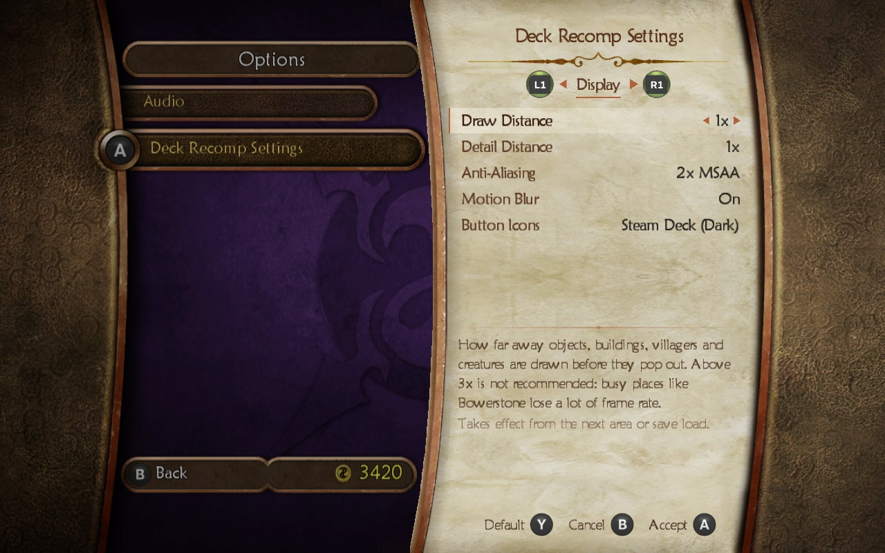

# Fable II for Steam Deck

**Fable II for Steam Deck** is a native SteamOS and Linux build of Fable 2 Recomp, the static recompilation of Fable II. It runs on Vulkan without Proton and targets 60 fps on the Deck, including in demanding areas such as Bowerstone. It adds selectable Steam Deck button icons, faster and adjustable menus, an in-game settings page, and a live minimap. [Fable 2 Recomp](https://github.com/himdo/Fable-2-Recomp)

**[⬇ Download the latest release](https://github.com/darokk/Fable-2-Recomp/releases/latest)** · [Install](#install) · [Playing](#playing) · [Deck Recomp features](#deck-recomp-features) · [Settings](#settings) · [Performance](#performance) · [Releases](#releases) · [Build from source](#building-from-source) · [Credits](#credits)

> [!IMPORTANT]
> The download holds **no game content**. You need your own copy of **Fable II Game of the Year Edition** as a disc image (`.iso`). This project does not condone piracy: links to or requests for game files will be removed.

## Install

You need SteamOS 3.6 or newer and about 7 GB of free space for the installation, in addition to the space used by your ISO. The release supports the USA/Europe, German, French, Italian, Russian and Spanish GOTY disc profiles. [Supported disc versions](https://github.com/darokk/Fable-2-Recomp/blob/steam-deck-linux/constants/game_versions.json)

1. Download the versioned `Fable2-SteamDeck-<version>.tar.gz` archive. [Latest release](https://github.com/darokk/Fable-2-Recomp/releases/latest)
2. In **Desktop Mode**, move the archive to `~/Games/` and choose *Extract* → *Extract archive here*. Extract it on the Deck to preserve the executable permissions. The archive creates a `Fable2-SteamDeck` folder.
3. Put your disc image in `~/Downloads`. The installer also looks in the game folder and on SD cards.
4. Open `Fable2.sh` and choose *Execute*. Select your ISO if prompted and let it extract the game files. With Steam running in Desktop Mode, choose **Add to Steam** when offered.

Start **Fable II** from your Steam library in **Gaming Mode** after setup. The game runs from the extracted files.

<details>
<summary>Manual setup</summary>

- To supply the game files yourself, copy `default.xex` and the whole `data` folder from your supported disc next to `Fable2.sh`.
- To add the shortcut yourself, open Steam in Desktop Mode and choose *Games* → *Add a Non-Steam Game to My Library*. Browse to `Fable2.sh`, using *All files* if needed, and leave the compatibility tool unset.
- To start from a terminal, run `./Fable2.sh` in the game folder.

</details>

### Updating

Close the game and extract the new archive over your existing `Fable2-SteamDeck` folder. Saves, game files and shader cache are kept. The archive replaces `fable2_config.toml` and `fable_2.toml`, so back up any settings you customised and copy those settings back after extracting.

### Uninstalling

Back up `saves/` if you want to keep your progress. Delete the `Fable2-SteamDeck` folder and remove the Fable II shortcut from Steam.

## Playing

- The Deck's controls work like an Xbox 360 controller.
- Your saves are in `saves/` inside the installation folder.
- For longer battery life, set **Frame Rate Cap** to 30 or 40 fps, or use Steam's Quick Access Performance menu.

### Known issues

- A texture or object can occasionally render incorrectly for a frame. With background shader compilation enabled, a new effect or part of an object can also appear a moment late the first time it is used.
- The window can stay white for a while during startup. **Skip Intro Videos** skips the logo videos and may shorten startup.

For a bug report, set `log_level = "info"` in `fable_2.toml`, reproduce the problem and attach the newest file from `logs/`. [Open an issue](https://github.com/darokk/Fable-2-Recomp/issues)

## Deck Recomp features

- **Steam Deck button icons.** The game and pub games use Deck glyphs styled to match Fable II. Choose **Steam Deck (Dark)**, **Steam Deck (Light)** or **Xbox 360** under **Display → Button Icons**, then restart the game to update its prompts.
- **Faster, adjustable menus.** Menus respond sooner by default, with quicker animations, a shorter delay before held directions repeat and faster scrolling as you keep holding. Each of those behaviours can be tuned in the **Interface** tab.
- **In-game settings.** Open **Options → Deck Recomp Settings** from the pause menu. The page uses the game's book layout and has **Performance**, **Display** and **Interface** tabs, with an explanation and timing for each setting. [How to use the settings page](#in-game-settings)
- **Live minimap.** The pause menu's region map tracks your hero and dog in the top-right corner while you play. Press **View** on the Deck or **Back** on an Xbox controller to show or hide it. The game remembers your choice. It moves below top-bar messages and follows HUD visibility. The **Interface** tab offers three sizes and opacity from 10% to 100%.

<p align="center">
  
  
</p>

<p align="center">
  
</p>

## Settings

### In-game settings

Pause the game and open **Options → Deck Recomp Settings**, after the game's own Game, Video, Controls and Audio pages. Switch tabs with **L1 / R1**, highlight a setting with **up / down** and change it with **left / right**. Press **Y** for the default, **A** to save to `fable2_config.toml`, or **B** to cancel. The page shows when each change takes effect.

| Tab | Setting | Default | What it does |
|---|---|---|---|
| Performance | Frame Rate Cap | 60 fps | 30, 40, 45, 60 fps or unlimited. The original game targets 30 fps |
| Performance | Async Shader Compilation | On | Compiles new shaders in the background to reduce stutter. Newly encountered effects or objects can appear a moment late |
| Performance | High Tick Rate | Off | Doubles the game's update rate for smoother menus and HUD and lower input delay. Experimental |
| Display | Draw Distance | 1x | How far objects, buildings and characters are drawn, up to 10x. Higher values can cost significant frame rate in busy areas. From the next area or save load |
| Display | Detail Distance | 1x | How far models keep full detail, up to 10x. Higher values can cost significant frame rate. From the next area or save load |
| Display | Anti-Aliasing | 2x MSAA | Off frees GPU time, with slightly jaggier edges (after a restart) |
| Display | Motion Blur | On | The camera's full-screen blur when it moves |
| Display | Button Icons | Steam Deck (Dark) | Steam Deck buttons in dark or light, or the original Xbox 360 buttons (after a restart) |
| Interface | Menu Hold Scroll Delay | 0.18 s | How long a held direction waits before the menu starts scrolling (original: 0.25 s) |
| Interface | Menu Animation Speed | 2.5x | How fast the menus slide and fade |
| Interface | Instant Menu Response | On | Menus react in the same update as the press |
| Interface | Menu Scroll Acceleration | 1.5x | Holding a direction speeds up scrolling |
| Interface | Skip Intro Videos | Off | Skips the logo videos at start-up, which may also make the game start faster |
| Interface | Minimap | On | Enables the live map and its View shortcut |
| Interface | Minimap Size | Medium | Small, medium or large |
| Interface | Minimap Opacity | 100% | 10% to 100%, in 10% steps |

### In the settings file

`fable2_config.toml` in the installation folder documents all game settings, including ones outside the in-game page. For example, `interpolation` under `[patches]` is on by default and smooths cloth motion on capes and coats.

## Performance

Steam Deck benchmarks with default graphics settings held around **60 fps** in demanding test scenes such as Bowerstone Old Town. With the cap removed, Old Town tests leading up to 1.0.5 reached about **65–68 fps**. Results vary with the area and graphics settings. Visiting new areas can still cause brief stalls while shaders and pipelines are prepared.

- **GPU.** Vulkan shaders are specialised for the signed and unsigned textures they read, reducing per-pixel checks. In one Deck comparison this reduced GPU cycles per frame by about 14%. The renderer also avoids render-target copies when clears can be applied directly and reduces GPU waits when the camera turns.
- **CPU.** The Steam Deck release builds use profile-guided optimisation from Deck play sessions, ThinLTO and a Zen 2 target. Recompiled register handling, native Lua garbage collection and less busy-waiting reduce CPU work.
- **Frame pacing.** The default cap is 60 fps on Deck. Background shader compilation is enabled and compiled shaders are cached for later runs. During gameplay, the minimap draws with the game frames so the Deck's FPS overlay still reflects the game's rate.

The renderer and runtime changes are on the SDK fork's Deck branch. [ReXGlue SDK fork](https://github.com/darokk/rexglue-sdk/tree/steam-deck-vulkan)

## Other changes and fixes

- The interface adapts to the Deck's 16:10 screen, and the main menu omits the *Downloadable Content* marketplace entry.
- The installer extracts your disc image on first launch and can add the game to Steam.
- The Linux build fixes a crash after committing a crime near guards and corrects Vulkan rendering of the hero and dog textures and eyes.
- The build includes fixes and features from upstream, including cloth interpolation and the MSAA toggle.

## Releases

| Version | Date | Highlights |
|---|---|---|
| [1.0.7](https://github.com/darokk/Fable-2-Recomp/releases/tag/steamdeck-1.0.7) | 2026-11-26 | Live minimap (View button), with size and opacity settings |
| [1.0.6](https://github.com/darokk/Fable-2-Recomp/releases/tag/steamdeck-1.0.6) | 2026-11-25 | Deck Recomp Settings page in Options, Draw and Detail Distance, Anti-Aliasing setting |
| [1.0.5](https://github.com/darokk/Fable-2-Recomp/releases/tag/steamdeck-1.0.5) | 2026-11-25 | Deck Recomp settings menu, smooth 60 fps in heavy scenes, async shader compilation |
| [1.0.4](https://github.com/darokk/Fable-2-Recomp/releases/tag/steamdeck-1.0.4) | 2026-11-23 | Faster in heavy scenes, optional MSAA off |
| [1.0.3](https://github.com/darokk/Fable-2-Recomp/releases/tag/steamdeck-1.0.3) | 2026-11-21 | First-start installer: game files from your disc image, *Add to Steam* |
| [1.0.2](https://github.com/darokk/Fable-2-Recomp/releases/tag/steamdeck-1.0.2) | 2026-11-20 | Crime/guard crash fixed, up to 7.5% faster, smooth capes and coats |
| [1.0.1](https://github.com/darokk/Fable-2-Recomp/releases/tag/steamdeck-1.0.1) | 2026-11-20 | Steam Deck button icons, faster menus |
| [1.0](https://github.com/darokk/Fable-2-Recomp/releases/tag/steamdeck-1.0) | 2026-11-19 | First Steam Deck release |

## Building from source

Use the game fork's `steam-deck-linux` branch and the SDK fork's `steam-deck-vulkan` branch. Pass the SDK checkout to the build script with `--sdk`.

```bash
git clone --branch steam-deck-linux https://github.com/darokk/Fable-2-Recomp.git
git clone --branch steam-deck-vulkan https://github.com/darokk/rexglue-sdk.git
cd Fable-2-Recomp
# Extract the game files into this checkout before building.
./build.sh --sdk ../rexglue-sdk --cpu deck package
```

See the Linux guide for dependencies, disc extraction and building on the Deck. [Linux build guide](https://github.com/darokk/Fable-2-Recomp/blob/steam-deck-linux/Linux.md)

The upstream project documentation covers the user config, in-game console, Lua scripts and developer tools. [Upstream documentation](https://github.com/darokk/Fable-2-Recomp/blob/steam-deck-linux/UPSTREAM-README.md)

## Credits

- **himdo and the Fable 2 Recomp contributors** built the recompilation, its patches, the native Linux build this fork starts from and the disc reader adapted for the installer. The project also provides the Windows build. [Fable 2 Recomp](https://github.com/himdo/Fable-2-Recomp)
- The **ReXGlue SDK** is the Xbox 360 static recompilation toolkit, built on the work of Xenia and XenonRecomp. [ReXGlue SDK](https://github.com/rexglue/rexglue-sdk) · [Xenia](https://github.com/xenia-project/xenia) · [XenonRecomp](https://github.com/hedge-dev/XenonRecomp)
- The Deck Recomp Settings page builds on Locme's Advanced Options work. [Advanced Options pull request](https://github.com/himdo/Fable-2-Recomp/pull/213)
- Steam Deck button glyphs were restyled for Fable II. The keyboard keycap font is Google Sans (SIL Open Font License).

Fable II is © Microsoft; this project is not affiliated with Microsoft, Lionhead Studios or Valve. The code is under the [MIT licence](LICENSE), like Fable 2 Recomp.
