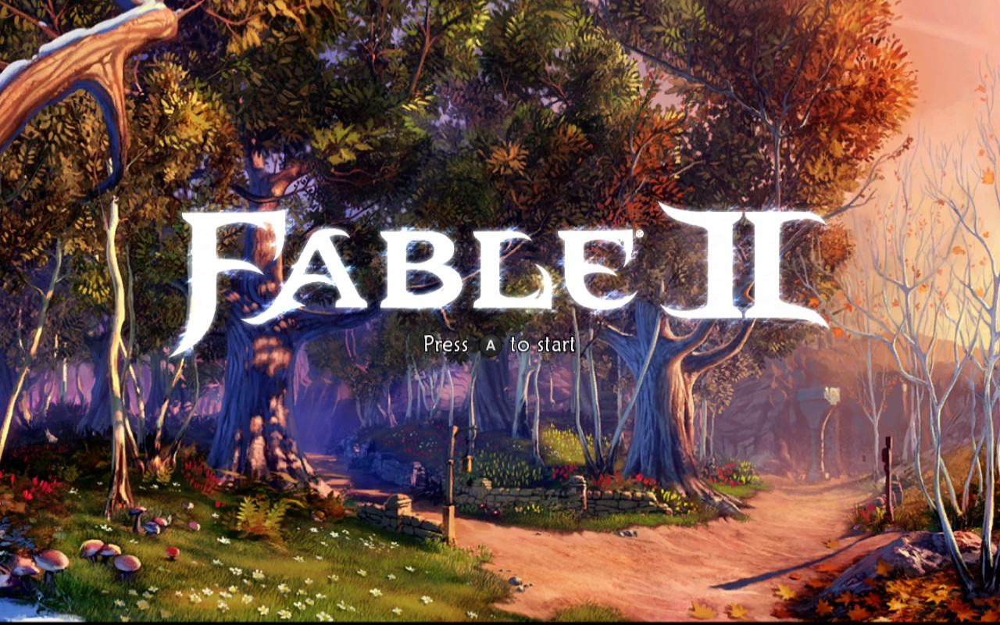
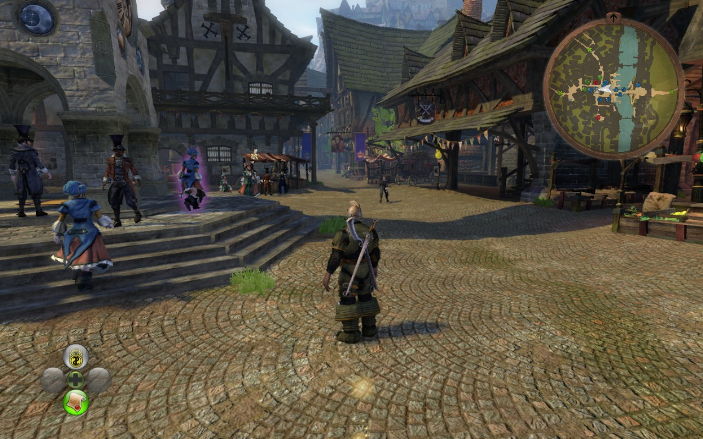

# Fable II for Steam Deck

A native **Steam Deck / Linux** version of [**Fable 2 Recomp**](https://github.com/himdo/Fable-2-Recomp), himdo's static recompilation of Fable II for PC. It runs directly on SteamOS with Vulkan, without Proton or an emulator, and is tuned for the Deck's CPU, GPU and 15 W power budget.

**[⬇ Download the latest release](https://github.com/darokk/Fable-2-Recomp/releases/latest)** · [Install](#install) · [Playing](#playing) · [Minimap](#minimap) · [Settings](#settings) · [Performance](#performance) · [What this fork changes](#what-this-fork-changes) · [Credits](#credits)

**A smooth 60 fps on the Steam Deck, even in the game's heaviest scenes** (apart from brief work the first time an area's shaders are seen), a live **minimap**, Steam Deck button icons, and an in-game **Deck Recomp Settings** page in the game's Options.

  
  

> [!IMPORTANT]
> The download holds **no game content**. You need your own copy of **Fable II Game of the Year Edition** as a disc image (`.iso`). This project does not condone piracy: links to or requests for game files will be removed.

## Install

You need a Steam Deck with SteamOS 3.6 or newer, your Fable II GOTY disc image, and about 7 GB of free space.

1. **Download** `Fable2-SteamDeck-<version>.tar.gz` from the [latest release](https://github.com/darokk/Fable-2-Recomp/releases/latest).
2. **Extract it on the Deck, in Desktop Mode:** move the file to `~/Games/` (the *Games* folder in your home folder), right-click it and choose *Extract* → *Extract archive here*. This creates the folder `Fable2-SteamDeck`.
3. **Put your disc image** (`.iso`) in `~/Downloads`. The `Fable2-SteamDeck` folder or an SD card work too.
4. **Double-click `Fable2.sh`** in the `Fable2-SteamDeck` folder and choose *Execute*. On the first start it:
   - finds your disc image and asks to extract the game files from it (about 6.7 GB, a few minutes, with a progress bar). If it can't find one, it lets you pick the file;
   - offers to **add Fable II to your Steam library**. Choose *Add to Steam*;
   - starts the game.

That's it: from now on, start **Fable II** from your library in **Gaming Mode** like any other game. The disc image isn't changed and isn't needed any more, so you can delete it.

Adding it to Steam by hand, copying the game files yourself

- **Steam shortcut by hand:** in Desktop Mode, open Steam → *Games* → *Add a Non-Steam Game to My Library*, browse to `Fable2.sh` (set the file type to *All files*) and add it. In the shortcut's *Properties → Compatibility*, make sure no Proton version is forced.
- **Game files by hand:** instead of the disc image, you can copy `default.xex` and the whole `data` folder from your disc into the `Fable2-SteamDeck` folder, next to `Fable2.sh`.
- **From a terminal:** `./Fable2.sh` asks the same questions in the terminal.

### Updating

Download the new release and extract it over your existing `~/Games/Fable2-SteamDeck` folder. Your saves, game files and shader cache stay where they are, and the game starts straight away. The settings file `fable2_config.toml` is replaced with the new defaults, so if you changed settings (in the file or in Deck Recomp Settings), back it up first and copy your changes back afterwards, or set them again in Deck Recomp Settings.

### Uninstalling

Delete the `Fable2-SteamDeck` folder (it holds everything: game files, saves, settings, logs, shader cache) and remove the Fable II shortcut from your Steam library.

## Playing

- **Controls:** the Deck's controls work like an Xbox 360 controller, with the Steam Deck's own buttons shown in the game's prompts.
- **Saves** are kept in `Fable2-SteamDeck/saves`. Back up that folder to keep your progress.
- **Minimap:** press the **View** button to show or hide the map in the top-right corner (see [Minimap](#minimap)).
- **Settings in the game:** pause the game and open *Options* → **Deck Recomp Settings** (see [Settings](#settings)).
- **First visits:** the first time an area's shaders are seen, they are prepared for the Deck's GPU, which can cause brief stalls. They are compiled in the background, so this is much reduced, and later visits are smooth.
- **Battery:** the game runs at up to 60 fps. For longer battery life, set the Quick Access Menu's Performance tab to 40 Hz with a 40 fps limit, or choose 30 or 40 fps under *Frame Rate Cap* in Deck Recomp Settings.

### Known issues

- A texture or object can occasionally render wrong for a single frame (as in the Windows version).
- On start-up the window can stay white for up to several minutes before the first video. Enabling the Skip Intro Videos setting seems to improve this.

If something goes wrong, the game shows an error with the path of its log file. For a bug report, set `log_level = "info"` in `fable_2.toml`, reproduce the problem and [open an issue](https://github.com/darokk/Fable-2-Recomp/issues) with the newest file from `logs/`.

## Minimap

  

The map from the pause menu, live in the top-right corner while you play: the region's own map in its wooden frame, with your hero's arrow and your dog on it, updated every frame. Press the **View** button (Back on an Xbox controller, M on the keyboard) to show or hide it; the choice is remembered.

- Every region has its own map, the same one the pause menu shows, including the chapter versions, caves and dungeons.
- When a message shows in the bar across the top of the screen, the map moves down with it, as the health bar does.
- It hides itself in menus, on loading screens, in photo mode and whenever the game hides its HUD.
- Size (small, medium, large) and opacity (100% to 10%) are in *Deck Recomp Settings* → Interface, and it can be turned off there.
- The frame rate the Deck's performance overlay shows stays the game's own while the map is on screen.

## Settings

### In the game: Deck Recomp Settings

Pause the game and open *Options* → **Deck Recomp Settings**, after the game's own Game, Video, Controls and Audio pages. It is a page of the game's book like theirs: switch tabs with **L1 / R1**, move with up / down, change a setting with **left / right**, press **Y** for its default, **A** to accept (saves to `fable2_config.toml`) or **B** to cancel (puts the changes back). Changes apply at once where they can; the page shows what each setting does and when it takes effect, and lists settings that need a restart.

| Tab | Setting | Default | What it does |
|---|---|---|---|
| Performance | Frame Rate Cap | 60 fps | 30 (the original game's lock), 40, 45, 60 or unlimited |
| Performance | Async Shader Compilation | On | New shaders are compiled in the background instead of pausing the game: fewer stutters, but a part of an object or an effect can appear a moment late the first time it's seen |
| Performance | High Tick Rate | Off | Runs the game's updates twice as often: smoother menus and HUD, less input delay. Experimental |
| Display | Draw Distance | 1x | How far away objects, buildings, villagers and creatures are drawn, up to 10x. Above 3x is not recommended: busy places like Bowerstone lose a lot of frame rate. From the next area or save load |
| Display | Detail Distance | 1x | How far out models keep their full detail, up to 10x; the same advice. From the next area or save load |
| Display | Anti-Aliasing | 2x MSAA | Off frees GPU time, with slightly jaggier edges (after a restart) |
| Display | Motion Blur | On | The camera's full-screen blur when it moves |
| Display | Button Icons | Steam Deck (Dark) | Steam Deck buttons in dark or light, or the original Xbox 360 buttons (after a restart) |
| Interface | Menu Hold Scroll Delay | 0.18 s | How long a held direction waits before the menu starts scrolling (original: 0.25 s) |
| Interface | Menu Animation Speed | 2.5x | How fast the menus slide and fade |
| Interface | Instant Menu Response | On | Menus react in the same update as the press |
| Interface | Menu Scroll Acceleration | 1.5x | Holding a direction speeds up scrolling |
| Interface | Skip Intro Videos | Off | Skips the logo videos at start-up, which may also make the game start faster |
| Interface | Minimap | On | The live map in the top-right corner; the View button shows and hides it |
| Interface | Minimap Size | Medium | Small, medium or large |
| Interface | Minimap Opacity | 100% | How solid it is drawn, 100% to 10% |

### In the settings file

All settings, including ones the page doesn't show, are in `fable2_config.toml` in the `Fable2-SteamDeck` folder (edit it in Desktop Mode with any text editor); each one is described in the file. A useful one that isn't on the page:

| Setting | Default | What it does |
|---|---|---|
| `interpolation` (`[patches]`) | `true` | Capes and coats move smoothly with the body |

## Performance

**A smooth 60 fps, even in the heaviest scenes.** With the default 60 fps cap, the game holds 60 fps on a Steam Deck in places like Bowerstone Old Town and Bowerstone Market, the heaviest scenes we test, with room to spare (Old Town runs at about 65 fps without the cap). The exception is the first time an area's shaders are seen: preparing them for the Deck's GPU can cause brief stalls, much reduced by compiling them in the background, and gone on later visits.

How it gets there, on top of Fable 2 Recomp and its native Linux build (renderer work in the [SDK fork](https://github.com/darokk/rexglue-sdk)):

**GPU**
- **Shaders specialised for the textures they read:** each shader is compiled for the texture formats actually bound to it, so the GPU no longer checks formats per pixel (about 14% less GPU time in heavy scenes).
- **Fewer render-target copies:** clears of the Xbox 360's render-target memory (EDRAM) are applied directly instead of being copied around.
- **Render target, GPU memory and occlusion query handling** reworked for the Deck, including the fix for stutters when turning the camera.
- **Async shader compilation:** new shaders and their specialised variants are compiled on background threads instead of stopping the game; compiled shaders are kept between sessions and across updates.

**CPU**
- **Profile-guided optimisation** from Deck play sessions, link-time optimisation across the game code and the renderer, and the Deck's Zen 2 CPU as the compile target.
- **Seven of the recompiler's eight register optimisations:** the game's registers live in native variables instead of memory, and atomic updates on the game thread are lock-free.
- **Waiting threads sleep instead of spinning,** including the render thread's wait for occlusion results, which leaves more of the Deck's 15 W budget to the GPU.
- **The Lua garbage collector,** about half of the game thread's time in busy areas, runs as native code.
- **Frame pacing:** 60 fps cap by default instead of the original 30 fps lock, no CPU wait for the GPU at the start of each frame, and one presented frame per game frame, so the Deck's performance overlay shows the real frame rate.

## What this fork changes

On top of Fable 2 Recomp and its native Linux build, besides the [performance work](#performance):

**Steam Deck experience**
- **Live minimap:** the pause menu's region map in the top-right corner, with your hero and dog, shown and hidden with the View button.
- **Deck Recomp Settings** in the game's Options: change the build's settings in the game, on a page in the game's own style, with an explanation for each.
- Steam Deck button icons in Fable II's own style, in the game and the pub games (dark, light or off).
- Faster, more responsive menus: instant response, a shorter hold delay, scroll acceleration and quicker animations, each adjustable.
- Menus laid out for the Deck's 16:10 screen, and no *Downloadable Content* entry in the main menu (there is no marketplace).
- First-start installer: finds your disc image, extracts the game files and adds the game to Steam.

**Fixes**
- A crash after committing a crime with guards nearby (Linux builds only).
- Correct hero and dog textures and eyes on Vulkan.

**From upstream**, pulled in when it's noteworthy: for example himdo's cloth interpolation (smooth capes and coats) and the option to turn off MSAA.

### Releases

| Version | Date | Highlights |
|---|---|---|
| [1.0.7](https://github.com/darokk/Fable-2-Recomp/releases/tag/steamdeck-1.0.7) | 2026-11-26 | Live minimap (View button), with size and opacity settings |
| [1.0.6](https://github.com/darokk/Fable-2-Recomp/releases/tag/steamdeck-1.0.6) | 2026-11-25 | Deck Recomp Settings page in Options, Draw and Detail Distance, Anti-Aliasing setting |
| [1.0.5](https://github.com/darokk/Fable-2-Recomp/releases/tag/steamdeck-1.0.5) | 2026-11-25 | Deck Recomp settings menu, smooth 60 fps in heavy scenes, async shader compilation |
| [1.0.4](https://github.com/darokk/Fable-2-Recomp/releases/tag/steamdeck-1.0.4) | 2026-11-23 | Faster in heavy scenes, optional MSAA off |
| [1.0.3](https://github.com/darokk/Fable-2-Recomp/releases/tag/steamdeck-1.0.3) | 2026-11-21 | First-start installer: game files from your disc image, *Add to Steam* |
| [1.0.2](https://github.com/darokk/Fable-2-Recomp/releases/tag/steamdeck-1.0.2) | 2026-11-20 | Crime/guard crash fixed, up to 7.5% faster, smooth capes and coats |
| [1.0.1](https://github.com/darokk/Fable-2-Recomp/releases/tag/steamdeck-1.0.1) | 2026-11-20 | Steam Deck button icons, faster menus |
| [1.0](https://github.com/darokk/Fable-2-Recomp/releases/tag/steamdeck-1.0) | 2026-11-19 | First Steam Deck release |

## Building from source

The code is on the [`steam-deck-linux`](https://github.com/darokk/Fable-2-Recomp/tree/steam-deck-linux) branch. It builds with the SDK fork [darokk/rexglue-sdk](https://github.com/darokk/rexglue-sdk) (branch `steam-deck-vulkan`); [Linux.md](https://github.com/darokk/Fable-2-Recomp/blob/steam-deck-linux/Linux.md) has the full instructions, including the Deck package (`./build.sh --cpu deck package`) and building on the Deck itself. The developer documentation of the main project (user config, in-game console, F5 Lua scripts, tracing, remote control) is in [UPSTREAM-README.md](UPSTREAM-README.md).

## Credits

- **[Fable 2 Recomp](https://github.com/himdo/Fable-2-Recomp)** by **himdo** and its contributors: the recompilation of Fable II itself, its patches, the native Linux build this fork starts from, and the disc reader that the installer's extractor is ported from. All credit for making Fable II run natively goes to them. For the Windows version, go there.
- **[ReXGlue SDK](https://github.com/rexglue/rexglue-sdk)**, the Xbox 360 static recompilation toolkit, built on the work of [Xenia](https://github.com/xenia-project/xenia) and [XenonRecomp](https://github.com/hedge-dev/XenonRecomp).
- Steam Deck button glyphs from a free glyph pack, restyled for Fable II. Keycap font: Google Sans (SIL Open Font License).

Fable II is © Microsoft; this project is not affiliated with Microsoft, Lionhead Studios or Valve. The code is under the [MIT licence](LICENSE), like Fable 2 Recomp.
