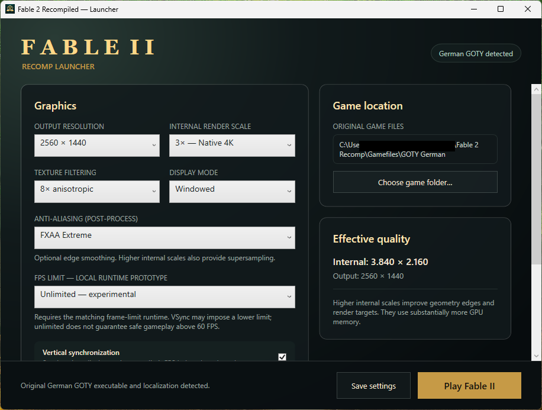

# Windows launcher

A .NET 8 WPF settings launcher for verified GOTY USA/Europe and German GOTY
dumps. It validates the original XEX and content markers, then checks the
native build descriptor. Unknown revisions and known mixed retail/TU1 content
are rejected; original game files are never modified.

## Extracting from an ISO

"Extract from ISO" opens a file picker for a raw Xbox 360 disc image (`.iso`)
and extracts straight into the folder the launcher is running from (next to
`fable_2.exe`) — there is no destination picker. The ISO content is written in
two phases:

1. **`default.xex` only** — extracted and SHA-256-hashed first.
2. **The remaining disc** (`data`, `nxeart`, `$SystemUpdate`, …) — written if
   the hash matches a known-good build in the version catalogue
   (`GameCompatibilityInspector.CheckHash`, same catalogue the launcher uses
   to validate game folders). If the hash does **not** match, extraction pauses
   on the progress screen with the reason and a red **Extract Anyways** button:
   click it to keep the XEX and write the rest of the disc, or press **Stop**
   to bail out (which deletes the ~21 MB XEX so nothing partial is left behind).

On success the launcher's folder is automatically set as the selected game
folder. The
GDFX/ISO 9660 readers come from the shared `X360Extract` library
(`tools/x360extract/lib`, referenced as a project dependency), so the output is
byte-for-byte identical to the standalone `x360extract` tool; STFS containers
are copied raw.

Settings: 720p/1080p/1440p/4K output, 1x–4x internal render scale, anisotropic
filtering (game default through 16x), none/FXAA/FXAA Extreme, VSync,
windowed/borderless/exclusive fullscreen and 30/60/120/144/165/240/unlimited FPS. Output size
is separate from the original 720p guest mode. The FPS options need the
matched source-built Release runtime described in
[the runtime guide](../docs/fix/runtime_fixes/technical.md). Higher rates are not a promise
of correct timing in every scene.

The **Advanced Options** button in the top bar opens a second page for the
recomp's own settings (stored in `fable2_config.toml` next to `fable_2.exe`,
separate from the engine's `fable_2.toml`):

- **Keybinds** — the keyboard→gamepad map as a list of editable rows (host key
  → guest input, with add/remove). Mouse look and mouse sensitivity are also
  here.
- **Patches** — a checkbox per recomp-level patch (unlock website/CE, skip
  intro videos, disable motion blur, realtime texture morphing, hero/dog
  texture readback, dog-fur depth bias).
- **Performance** — the hot-function yield-batching factor.

The Save button writes only the managed keys back to `fable2_config.toml`
non-destructively: it updates keys in place (keeping indentation, spacing and
inline comments), appends any missing keys or sections, leaves every other key
and section untouched, and makes a one-time `.launcher-backup` before the first
write. Keybind and patch changes take effect the next time the game launches.

## Updating in place

A packaged release asks GitHub for the latest release when the launcher opens.
If there is a newer one, the top bar shows **Update to x.y.z**. Clicking it
asks first, then downloads the release zip, checks it, and replaces the files
in the launcher's own folder. The launcher restarts into the new version.

What an update does to the folder:

| Files | What happens |
|---|---|
| The release's own files: `fable_2.exe`, the DLLs, `Fable2Launcher.exe`, `fable2_build.json`, `README.md`, `licenses`, `assets`, `data\scripts\recomp\*.lua` | Replaced when they differ, added when new, removed when the new release no longer has them |
| Settings: `fable2_config.toml`, `fable_2.toml`, `launcher-settings.toml` and any other `.toml` next to the exe | Kept. The zip's default `fable2_config.toml` is only installed when there is none |
| `saves`, `cache`, `logs`, `screenshots`, `launcher-game-path.txt`, `.launcher-backup` and `.bak` files | Kept |
| The extracted game: `default.xex`, `nxeart`, `$SystemUpdate` and everything in `data` except `data\scripts\recomp` | Kept |
| Anything else you put in the folder, your own scripts in `data\scripts\recomp` included | Kept |

If you had edited one of the release's own files (a recomp Lua script, for
example), it is replaced like the others, and your version is copied to
`launcher-update-backup\<old version>` first. New settings a release adds are
not written into your `fable2_config.toml`; the game uses its defaults for
keys the file does not have.

Nothing in the folder changes until the download has passed every check: its
size and SHA-256 against what GitHub states for the release, and every file in
it against the list of checksums in the zip's `fable2_build.json`. The update
is refused, with the reason, when a check fails, when the game is running,
when the folder can't be written to or the disk is too full, and when the
release is packaged in a way the launcher does not know. In those cases the
overlay offers the release page for a manual update, as before.

The switch itself renames files inside the folder and keeps every old file in
`launcher-update` until it is done. If a step fails, the old files are moved
back. If the launcher or the PC dies during the switch, the next launcher
start moves them back. Should that ever leave the folder without a
`Fable2Launcher.exe`, the previous one is in `launcher-update\backup`.
`launcher-update` is removed once the new launcher has started; the old
launcher can't delete its own exe while it runs.

The checksums catch a damaged or swapped download. They do not prove who
published the release: an update is trusted exactly as much as a zip you
download from the release page yourself.

Releases before the first one with this feature have no list of files, so
they can't be installed this way. The update needs a launcher that has the
feature and a newer release that was packaged with `build.cmd package`.

Dropdowns use dark text on a light background, including the selected item.
The launcher and game use a project-owned book/tree icon documented in
[asset provenance](../assets/README.md).

Build from the repository root:

```cmd
build.cmd launcher                 self-contained (default; ships with .NET)
build.cmd launcher-dev             framework-dependent (needs .NET installed)
dotnet run --project tests/Fable2.Launcher.ConfigTests -c Release
```

The tests also cover the extraction hash gate (every known-good hash is
accepted, every unsupported/unknown hash is rejected before extraction).

## Shipping without a .NET install

The default build is a **self-contained single-file publish**: the .NET 8
Desktop Runtime is bundled inside `Fable2Launcher.exe` (~160 MB), so users
need no .NET install and no separate runtime installer is shipped. The same
applies to `x360extract.exe` (see `tools/x360extract`, default build is
self-contained too). `build.cmd launcher-dev` produces the small
framework-dependent exe for fast local iteration; it requires the .NET 8
Desktop Runtime on the target machine.

Output is `out/tests/launcher-build/Fable2Launcher.exe`. Put it beside
`fable_2.exe`, its matched DLLs, `fable2_build.json` and `app-icon.png`.

The launcher defaults to its own folder on first launch and remembers the
selected location in `launcher-game-path.txt` beside it. No developer path,
global fallback or automatic dump selection is embedded. The directory must
be writable to persist settings.

`launcher-settings.toml` stores only the managed preferences. The launcher
reads existing `fable_2.toml` first for legacy configurations, then overlays
those preferences so runtime rewrites cannot reset output resolution or render
scale. Save/start writes both files. Unknown engine settings are preserved,
and the first engine-config write creates a one-time backup. Saves, caches and
logs remain beside the native EXE, not in the original dump.

F3 in the game shows the guest-swap FPS counter in Release.
`StartWithoutAudio.cmd`, staged with the native EXE, exercises the clocked
silent fallback without disabling any Windows device. Exit existing game and
launcher processes before running that test.

### Keyboard and mouse prompt images

If an action has several bindings, the prompt prefers a regular key
over an alternate mouse button or modifier. Unbound controls retain their
original artwork. The main-menu selection badge uses separate artwork and
still shows the controller's A button.

The game loads these textures at startup. Relaunch after changing bindings.

The option requires a writable extracted game folder on NTFS. It creates a
read-only game-data view with two generated GUI banks and hard links to the
other files. Your disc image and extracted banks are preserved. The launcher
can reuse the view under `cache/keyboard-prompts` in the game-data folder.
This cache can be removed while the game and launcher are closed. Saves
continue to use the existing save folder beside the executable.


Launcher overview supplied by the tester (before the high-refresh presets were added):


